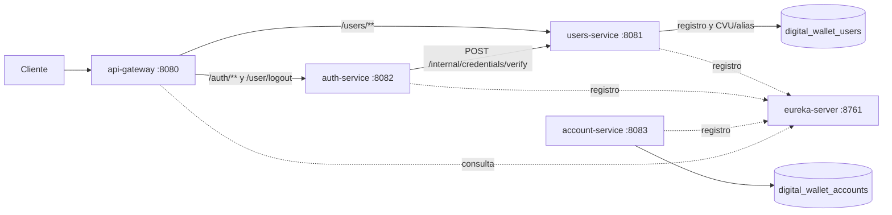
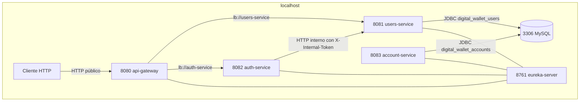

# Arquitectura

Digital Money House del Sprint 1 es un conjunto de servicios Spring Boot. Cada carpeta es un proyecto Maven propio. El cliente entra por el API Gateway. Eureka resuelve el nombre de cada servicio.

## Diagrama de arquitectura

`/internal/**` no tiene ruta en el gateway. Auth llama a users por el nombre de Eureka y envía el header `X-Internal-Token`. Users responde 401 si el header no coincide y nunca devuelve el hash de la contraseña.

## Esquema de red

Todo corre en la máquina local. MySQL escucha en `localhost:3306`. El resto de los puertos son HTTP.

| Origen | Destino | Puerto | Qué circula |
|---|---|---|---|
| Cliente | api-gateway | 8080 | Registro, login y logout |
| api-gateway | users-service | 8081 | `/users/**` |
| api-gateway | auth-service | 8082 | `/auth/**` y `/user/logout` |
| auth-service | users-service | 8081 | Verificación de credenciales, solo con clave interna |
| users-service | MySQL | 3306 | Base `digital_wallet_users` |
| account-service | MySQL | 3306 | Base `digital_wallet_accounts` |
| Cada servicio | eureka-server | 8761 | Registro y descubrimiento |

## Dueño de la cuenta

`users-service` es el dueño de la identidad de la cuenta durante el Sprint 1: CVU, alias, saldo inicial en cero y el vínculo uno a uno con el usuario. Esa fila se crea en la misma transacción que el alta, así el registro no depende de otro servicio.

`account-service` no duplica esa entidad. En el Sprint 2 va a ser el dueño de las operaciones financieras (movimientos de saldo, transacciones y tarjetas) y va a referenciar el id de cuenta que ya devolvió el registro. Así no hay que mudar la identidad de la cuenta ni partir el alta en dos bases.

## JWT en el gateway

En el Sprint 1 el gateway no valida tokens. Las tres rutas públicas son el registro, el login y el logout. El logout valida el JWT dentro de `auth-service`: un token vencido, alterado o ya invalidado no cierra sesión ni queda en la blacklist.

Cuando aparezcan endpoints protegidos, la validación del JWT se centraliza en `api-gateway`, antes de enrutar. Login, registro y la documentación OpenAPI siguen públicos. La firma, la expiración y la blacklist se resuelven una sola vez en el borde y los servicios dejan de repetir ese control.
