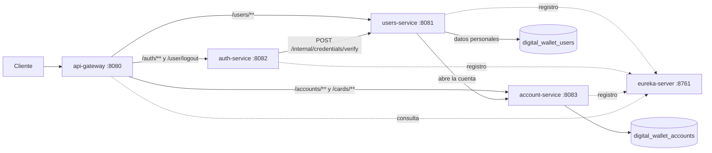
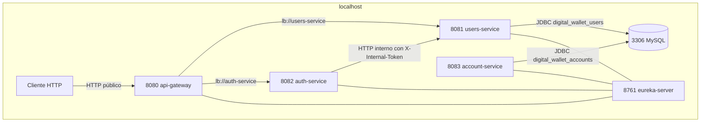

# Arquitectura

Digital Money House es un conjunto de servicios Spring Boot. Cada carpeta es un proyecto Maven propio. El cliente entra por el API Gateway. Eureka resuelve el nombre de cada servicio.

## Diagrama de arquitectura

`/internal/**` no tiene ruta en el gateway. Auth llama a users por el nombre de Eureka y envía el header `X-Internal-Token`. Users responde 401 si el header no coincide y nunca devuelve el hash de la contraseña.

## Esquema de red

Todo corre en la máquina local. MySQL escucha en `localhost:3306`. El resto de los puertos son HTTP.

| Origen | Destino | Puerto | Qué circula |
|---|---|---|---|
| Cliente | api-gateway | 8080 | Registro, login y logout |
| api-gateway | users-service | 8081 | `/users/**` |
| api-gateway | auth-service | 8082 | `/auth/**` y `/user/logout` |
| auth-service | users-service | 8081 | Verificación de credenciales, solo con clave interna |
| users-service | MySQL | 3306 | Base `digital_wallet_users` |
| account-service | MySQL | 3306 | Base `digital_wallet_accounts` |
| Cada servicio | eureka-server | 8761 | Registro y descubrimiento |

## Dueño de la cuenta

`users-service` guarda los datos personales. Al registrarse llama a `account-service`, que crea la cuenta con CVU, alias y saldo inicial en cero. El id que vuelve en el alta es el de esa cuenta.

`account-service` es el dueño del saldo, de los movimientos, del alias y de las tarjetas. El perfil lee el CVU y el alias desde ahí.

## JWT en el gateway

El gateway valida el JWT antes de enrutar `/accounts/**`, `/cards/**` y `/users/**`, salvo `POST /users/register`. Login y logout siguen públicos. Un token vencido o ausente responde 403. Cada servicio además comprueba que la cuenta o el usuario pertenezcan al email del token.
